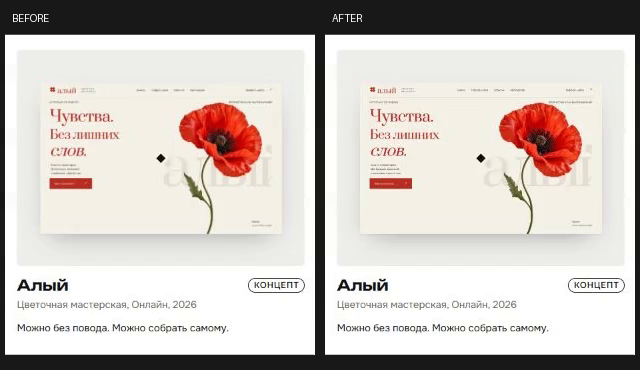
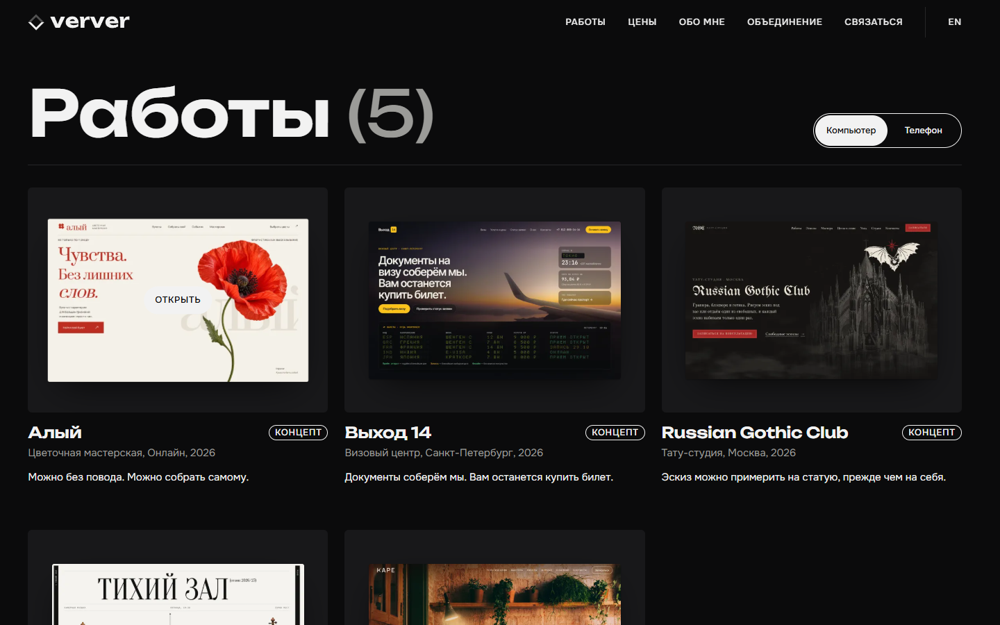
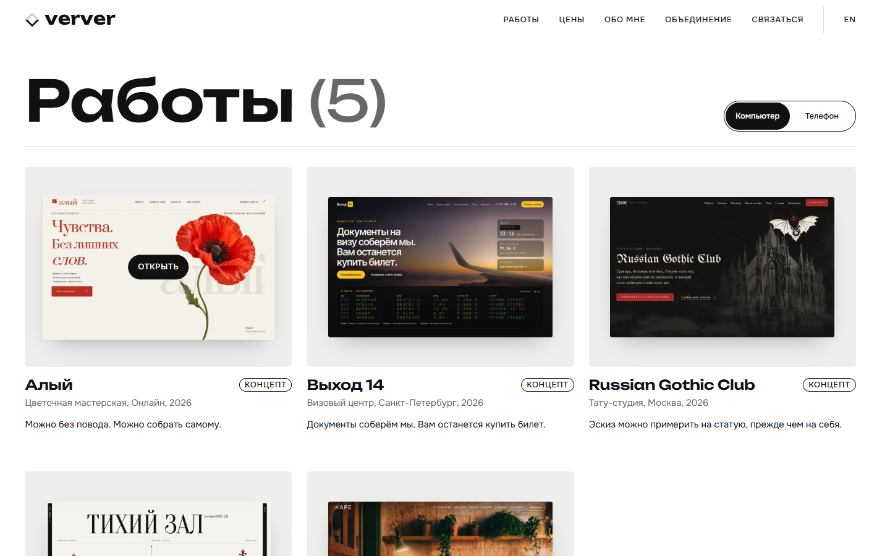
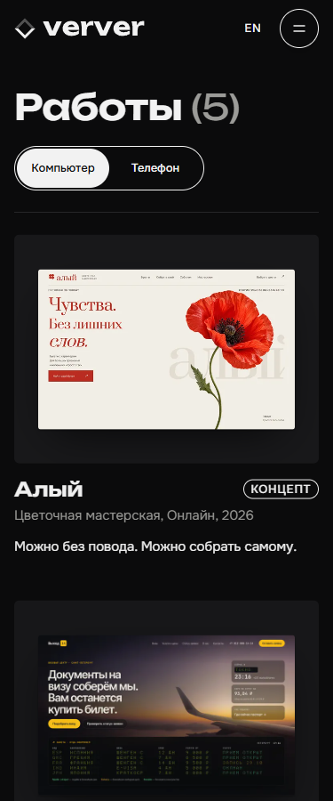

# Hover-превью: проверка 24.10.2026

Запрос: увеличение скриншота в «Работах» ощущается ступенчатым, как будто ширина и высота растут по очереди. В присланной записи 394×422, 30 fps, 7,7 с видны повторные наведения. По этой записи нельзя отделить кадры браузера от пропусков захвата.

Изменение: `will-change: transform` только у выбранного вида превью, при точном указателе, поддержке hover и обычном движении. Масштаб 1,035, кривая и 600 мс прежние. Плата — дополнительные compositor-слои у выбранных скриншотов (сейчас пять карточек). При touch и reduced-motion подсказки нет. Откат — удалить добавленное правило.

## Замеры

Локальная production-сборка, Edge Chromium headless, 1440×900, DPR 1, ANGLE / NVIDIA RTX 4060 Ti / Direct3D11. Аппаратный renderer проверен через WebGL и CDP SystemInfo. Эти результаты не относятся к ранее доступному UI-сеансу Zen, который сообщил другой GPU (GTX 980).

Каждый вариант: три полных hover-in/out и три быстрых прерывания по 150 мс. До — та же сборка с `will-change: auto !important`, после — настоящий CSS правки. Между сериями выдержана пауза, картинки и шрифты загружены. Это один сравнительный прогон, а не статистическая оценка всех устройств.

| Метрика | До | После |
| --- | ---: | ---: |
| Layout, CPU ×1 | 12 | 0 |
| Paint, CPU ×1, суммарно | 3,80 мс | 1,08 мс |
| rAF p95, CPU ×1 | 7,0 мс | 7,0 мс |
| Максимальный интервал rAF, CPU ×1 | 34,7 мс | 7,1 мс |
| Layout, CPU ×4 | 12 | 0 |
| Paint, CPU ×4, суммарно | 18,15 мс | 4,71 мс |
| rAF p95, CPU ×4 | 7,0 мс | 7,0 мс |
| Максимальный интервал rAF, CPU ×4 | 7,2 мс | 7,2 мс |
| Long tasks >50 мс, оба режима | 0 | 0 |

rAF — интервалы callbacks, не измерение частоты физического дисплея. Paint — события главного потока из CDP trace, не время GPU raster. Единичные 34,7 мс сами по себе не доказывают причину жалобы. Подтверждено снижение layout/paint; устранение субъективной ступенчатости в Zen ещё не подтверждено.

В 241 отсчёте DOMMatrix при прерывании и повторном наведении X и Y равны: максимальная разница 0. Код не увеличивает оси по очереди. Восприятие раздельного движения может быть связано с растеризацией или записью, но это гипотеза.

## Визуальная проверка

[Короткое видео до/после](hover-comparison.mp4) — реальный CDP screencast, сведённый по timestamps к 30 fps. Слева исходный слой, справа подготовленный. Захват влияет на производительность и не заменяет проверку в Zen; метрики выше записаны отдельно, без screencast. Оба варианта сохранены, размер 1,035 и геометрия одинаковы.

Проверено автоматически:

- Геометрия ссылок-карточек до/после идентична.
- Обе темы; масштаб 1,035 для выбранных desktop/phone превью, opacity 1 после переключения.
- Прерывание и повторное наведение: обе оси синхронны.
- 375 px touch: ширина документа 375, `will-change: auto`. На 768/1280 нет переполнения; 15 px занимает полоса прокрутки.
- Reduced-motion: transform none, will-change auto.
- На главной сцена WebGL готова; прокрутка к кольцу и карточкам в обе стороны, открытие кейса из сетки с scrollY 0.
- Все пять кейсов: открытие, прокрутка вниз и обратно, без pageerror.
- Production build с TypeScript прошёл. Полная проверка репозитория запускается в CI PR.

Не проверено: физический iPhone/Safari, Android, масштаб Windows 125/150 %, непрерывный профиль GPU всей 3D-сцены, полная плавность переходов между всеми разделами, Zen в тех же условиях записи. Главная и кейсы пройдены как smoke-check; это не полный performance-аудит сайта.

## Review animations

| До | После | Зачем |
| --- | --- | --- |
| На повторных hover фиксируются layout и paint сетки | Выбранный скриншот сохраняет слой между наведениями | Убирает подтверждённую лишнюю работу без изменения движения |

**Approve** для узкой CSS-правки: compositor-свойство transform, прежние сроки и прерываемый CSS transition, hover ограничен точным указателем, reduced-motion сохраняется. Это не приёмка всей анимации сайта и не подтверждение устранения рывков у владельца. До публикации нужна его визуальная оценка.

